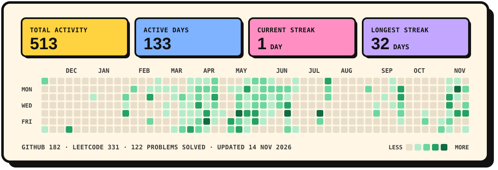

<a href="https://tusharcode007.github.io/rstushar_portfolio/">
  <picture>
    <source media="(prefers-color-scheme: dark)" srcset="assets/header-dark.svg">
    
  </picture>
</a>

  
  
  
  

## 👋 About me

I'm a second-year Computer Science student at **Scaler School of Technology** (dual degree with **BITS Pilani**), based in Bengaluru.
I build full-stack products with React, Node.js and TypeScript, dig into LLM tooling, and write bug reports that maintainers
can act on without asking a single follow-up question.

- 🐛 Contributing to **MIT App Inventor** and **GirlScript Summer of Code '26** projects
- 🧠 Building AI products like **GradeSense**, an LLM-powered exam grader with rubric-level evidence
- 🤝 Head of Partnerships at **E-Cell, Scaler School of Technology**
- 🌱 Going deeper on TypeScript and system design
- 💼 Open to internships and collaborations

## 📈 Activity

<a href="https://tusharcode007.github.io/rstushar_portfolio/#activity">
  <picture>
    <source media="(prefers-color-scheme: dark)" srcset="https://raw.githubusercontent.com/Tusharcode007/Tusharcode007/output/activity-dark.svg">
    
  </picture>
</a>

GitHub contributions + LeetCode submissions in one calendar · refreshed every 6 hours · <a href="https://tusharcode007.github.io/rstushar_portfolio/#activity">interactive version</a> · <a href="https://leetcode.com/u/Z2N2oTuz4h/">LeetCode profile</a>

## 🐛 Open source

| Project | What I did | Status |
| :-- | :-- | :-- |
| **[MIT App Inventor](https://github.com/mit-cml/appinventor-sources)** | [**#4204**](https://github.com/mit-cml/appinventor-sources/issues/4204) — `ShareFile` and `ShareFileWithMessage` reported each other's name in `Screen.ErrorOccurred`: an inverted condition in `Sharing.java` dating back to 2014 · [fix + Robolectric test](https://github.com/Tusharcode007/appinventor-sources/tree/fix-sharing-error-method-name) |   |
| | [**#4209**](https://github.com/mit-cml/appinventor-sources/issues/4209) — `XMLTextDecode` reported bad XML as JSON error 1105 instead of the never-used XML error 1115, and iOS disagreed between the two decode blocks · [fix for Android + iOS](https://github.com/Tusharcode007/appinventor-sources/tree/fix-web-xml-decode-error-code) |   |
| | [**#3876**](https://github.com/mit-cml/appinventor-sources/issues/3876#issuecomment-6502349094) — traced the README's Java 11 vs 17 confusion to the new backend and flagged a leftover `java17` runtime |  |
| **[FindMyGSoC](https://github.com/S3DFX-CYBER/FindMyGSoC)** · GSSoC '26 | [**#511**](https://github.com/S3DFX-CYBER/FindMyGSoC/issues/511) — organization modal: card body didn't open it, backdrop didn't close it, close button scrolled out of view |   |
| **[TeaAndBooks](https://github.com/vie-nyx/TeaAndBooks)** · GSSoC '26 | [**#25**](https://github.com/vie-nyx/TeaAndBooks/issues/25) — Create Group modal: Create button, Enter key and backdrop close all broken |   |
| | [**#26**](https://github.com/vie-nyx/TeaAndBooks/issues/26) — the same user could review a book multiple times |   |
| | [**#27**](https://github.com/vie-nyx/TeaAndBooks/issues/27) — no way to delete or edit your own posts in the feed |   |

> **How I write a bug report:** environment → numbered repro steps → expected vs. actual → evidence (screenshots or the exact source line) → impact. Maintainers can triage it cold.

## 🛠️ Things I've built

<table>
  <tr>
    <td width="50%" valign="top">
      <h3>📝 GradeSense</h3>
      AI exam grader: upload a question paper, an answer PDF and a rubric. An LLM grades every criterion with verbatim evidence,
      a 7-step validation pipeline blocks hallucinated points, handwritten PDFs fall back to OCR, and feedback comes back as an annotated PDF.
        
      <code>TypeScript</code> <code>Express</code> <code>React</code> <code>Groq LLM</code> <code>Tesseract.js</code> <code>SQLite</code>
        
      <a href="https://github.com/Tusharcode007/gradeSense"><b>Code ↗</b></a>
    </td>
    <td width="50%" valign="top">
      <h3>⚙️ FlowForge</h3>
      A project-execution workspace: turn projects into tasks, track real completion and spot overdue work at a glance.
      Email/password auth and per-user data isolation through Supabase Row Level Security.
        
      <code>React 19</code> <code>TypeScript</code> <code>Vite</code> <code>Supabase</code> <code>PostgreSQL</code>
        
      <a href="https://flow-forge-neon-nine.vercel.app/"><b>Live demo ↗</b></a> · <a href="https://github.com/Tusharcode007/FlowForge-"><b>Code ↗</b></a>
    </td>
  </tr>
  <tr>
    <td width="50%" valign="top">
      <h3>🛒 ShopKartt</h3>
      Full-stack store: catalog search and filters, a cart synced to the signed-in customer, JWT auth in HTTP-only cookies, and Razorpay
      checkout (test mode) with server-side price and stock checks plus HMAC signature verification.
        
      <code>React</code> <code>Express</code> <code>MongoDB</code> <code>JWT</code> <code>Razorpay</code>
        
      <a href="https://github.com/Tusharcode007/shopkartt"><b>Code ↗</b></a>
    </td>
    <td width="50%" valign="top">
      <h3>📚 AI-Powered Study Companion</h3>
      An 8-module React SPA: topic notes, filterable tasks, an automatic revision planner, a Recharts analytics dashboard and an
      AI-style assistant for summaries, flashcards and practice questions. Fully client-side.
        
      <code>React</code> <code>JavaScript</code> <code>Recharts</code> <code>LocalStorage</code>
        
      <a href="https://tusharcode007.github.io/rst-AI-Powered-Study-Companion-/"><b>Live demo ↗</b></a> · <a href="https://github.com/Tusharcode007/rst-AI-Powered-Study-Companion-"><b>Code ↗</b></a>
    </td>
  </tr>
  <tr>
    <td width="50%" valign="top">
      <h3>⏱️ Productivity Booster</h3>
      A neo-brutalist all-in-one dashboard: Pomodoro timer, meditation zone, prioritised tasks, habit tracking and goals,
      plus a live theme customiser. Runs entirely in the browser — no login, no backend.
        
      <code>HTML</code> <code>CSS</code> <code>JavaScript</code> <code>LocalStorage</code>
        
      <a href="https://productivity-booster-b27e.vercel.app/"><b>Live demo ↗</b></a> · <a href="https://github.com/Tusharcode007/PRODUCTIVITY-BOOSTER"><b>Code ↗</b></a>
    </td>
    <td width="50%" valign="top">
      <h3>🔍 TokenSense</h3>
      Hackathon team project: a CLI that analyses LLM API usage logs, runs 4 deterministic waste-detection rules, breaks costs down
      per team with week-over-week trends, and recommends fixes with monthly savings estimates — in the console or as a Slack digest.
        
      <code>TypeScript</code> <code>Node.js</code> <code>CLI</code> <code>LLM APIs</code>
        
      <a href="https://github.com/Tusharcode007/TokenSense"><b>Code ↗</b></a>
    </td>
  </tr>
</table>

Also: [**MakeSense AI**](https://github.com/Tusharcode007/makeSENSE) (assistant that acts on Google Calendar, Gmail & Drive) ·
[**calSync**](https://github.com/Tusharcode007/calSync) (voice-enabled routines synced to Google Calendar) ·
[**Build-your-own Shell**](https://github.com/Tusharcode007/codecrafters-shell-java) (POSIX-style shell in Java)

## 🧰 Tech stack

  <picture>
    <source media="(prefers-color-scheme: dark)" srcset="https://skillicons.dev/icons?i=js%2Cts%2Cjava%2Creact%2Cvite%2Cnodejs%2Cexpress%2Cmongodb%2Cmysql%2Cpostgres%2Csupabase%2Csqlite%2Cgit%2Cgithub%2Clinux%2Cvscode&perline=8&theme=dark">
    
  </picture>

## 📊 GitHub stats

  <picture>
    <source media="(prefers-color-scheme: dark)" srcset="https://raw.githubusercontent.com/Tusharcode007/Tusharcode007/output/stats-dark.svg">
    
  </picture>
  <picture>
    <source media="(prefers-color-scheme: dark)" srcset="https://raw.githubusercontent.com/Tusharcode007/Tusharcode007/output/top-langs-dark.svg">
    
  </picture>

  <picture>
    <source media="(prefers-color-scheme: dark)" srcset="https://streak-stats.demolab.com/?user=Tusharcode007&background=1B1B1B&border=F4EFE6&stroke=F4EFE6&ring=FF8FC3&fire=FFD23F&currStreakNum=F4EFE6&sideNums=F4EFE6&currStreakLabel=FFD23F&sideLabels=F4EFE6&dates=CFC8BC&border_radius=10">
    
  </picture>

Header and banner are hand-made SVGs · the activity calendar and stats regenerate via GitHub Actions

